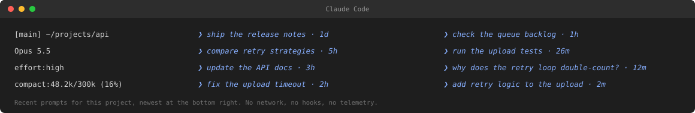

# Prompt History Bar

A Claude Code status line that shows the recent prompts for the **current
project** in a right-side column, newest at the bottom, each with an age.



The left side is the usual status line information: project and branch, model,
effort level, and context budget. The right side answers a different question:
*what was I just working on here?*

## Why

Claude Code remembers prompt history, but it is buried in the input history.
The status line is always visible, so it is a good place for the last few
inputs in this project. The bar is scoped to the project directory, so a
different repository shows a different list. Two sessions in the same
directory share that list unless you install with `--session`.

## Install

### From this repository's marketplace

The `xqpmjh/plugins` repository is its own plugin marketplace, so installing does
not depend on the Claude plugin directory:

```text
/plugin install prompt-history-bar --marketplace xqpmjh/plugins
```

Or add the marketplace once, then install from `/plugin`:

```text
/plugin marketplace add xqpmjh/plugins
/plugin install prompt-history-bar@xqpmjh-plugins
```

Start a new Claude Code session, then run `/prompt-history-bar`. The skill
locates its own installer and asks for confirmation before editing settings.

### As a personal skill

```bash
git clone https://github.com/xqpmjh/plugins.git
mkdir -p ~/.claude/skills
cp -R plugins/plugins/prompt-history-bar/skills/prompt-history-bar ~/.claude/skills/
bash ~/.claude/skills/prompt-history-bar/scripts/install.sh --dry-run
bash ~/.claude/skills/prompt-history-bar/scripts/install.sh
```

`install.sh` is a wrapper around `install.py`; both do the same thing, and the
`.py` one is what to use if a distribution channel does not ship shell scripts.

The installer copies the runtime to `~/.claude/statusline/prompt-history-bar/`
and adds a `statusLine` entry to `~/.claude/settings.json`. It backs up the
settings file, validates the result, and refuses to overwrite a different
`statusLine` unless you pass `--force`.

Start a new Claude Code session afterwards. The status line is skipped until
the workspace trust prompt is accepted.

### Options

| Option | Effect |
|---|---|
| `--lang en\|zh` | Age labels in English (default) or Chinese |
| `--paste` | Show the agent's reply line (or the paste's first line) instead of `[paste]` |
| `--session` | Show only the current session's prompts instead of the whole directory |
| `--refresh N` | Also re-run the status line every N seconds (whole number, minimum 1), so the bar and its age labels update while Claude is busy or idle |
| `--force` | Replace an existing, different `statusLine` command |
| `--dry-run` | Print the change without writing |
| `--uninstall` | Remove the `statusLine` entry |
| `--purge` | With `--uninstall`, also remove the runtime copy |

## Requirements

- Claude Code with status line support.
- Python 3.8 or newer (`python3` on `PATH`).
- macOS or Linux. Windows is not tested.
- tmux is optional but recommended: it gives the exact pane width. Claude Code
  also sets `COLUMNS` for status line commands; the script prefers tmux, then
  `COLUMNS`, then `/dev/tty`, then a cached width, then 120.

The status line input JSON has no terminal width, so width detection is
best-effort. Set `CLAUDE_HISTORY_WIDTH` to pin it.

## Configuration

Set environment variables in the shell that launches Claude Code:

| Variable | Default | Meaning |
|---|---|---|
| `CLAUDE_HISTORY_LANG` | `en` | `en` or `zh` age labels |
| `CLAUDE_HISTORY_PASTE` | off | `1` to show the agent's reply line, or the paste's first line, for pasted text |
| `CLAUDE_HISTORY_CHOICES` | on | `0` to hide choice-box answers (read from the session transcript) |
| `CLAUDE_HISTORY_SCOPE` | directory | `session` to list only the running session's prompts |
| `CLAUDE_HISTORY_WIDTH` | auto | Force a width in terminal cells |
| `CLAUDE_HISTORY_STYLE` | italic blue | ANSI style for history cells |
| `DEBUG` | off | `1` to log width decisions |

If the bar uses the wrong width after a resize, set `CLAUDE_HISTORY_WIDTH` or
restart the session; the last successful width is cached per pane/session.

## Privacy and data access

Everything stays on the machine. There are no network calls, no hooks, and no
telemetry.

| Read | When | Why |
|---|---|---|
| `~/.claude/history.jsonl` | every render | the prompts shown in the bar |
| `~/.claude/paste-cache/<hash>.txt` | only with `CLAUDE_HISTORY_PASTE=1` | paste preview |
| `~/.claude/projects/*/<session>.jsonl` | every render, unless `CLAUDE_HISTORY_CHOICES=0`; also with `CLAUDE_HISTORY_PASTE=1` | choice-box answers (last 4 MiB scanned); with the paste preview, the agent's first reply line to a paste |
| `~/.claude/settings.json` | install/uninstall only | register/remove `statusLine` |
| `git -C <project> rev-parse` | every render | branch name on the left |

`history.jsonl` contains prompt text. The bar displays it; avoid screen-sharing
or recording when it contains sensitive inputs. Paste previews are opt-in for
the same reason.

The history file is an internal Claude Code file, not a public API. The reader
degrades gracefully when it is missing or a record cannot be parsed, but its
format can change. Tested against the installed Claude Code on 2026-10-27.

## How it works

`statusline.py` reads Claude Code's JSON from stdin, builds up to four left
rows, and calls `history_bar.render_statusline`. The history reader scans
`history.jsonl` backwards in 64 KiB blocks and stops as soon as it has enough
entries for the current project, so cost does not grow with the file size. It
matches both the logical project path and its realpath, tries parents up to
the git root (four levels at most; none when there is no `.git`), and ignores bash-mode inputs (`!...`), UI commands (`/effort`,
`/model`, ...), exit words, and inputs that are only image
placeholders (an input that is only a paste is shown as its first line with the
preview on, and skipped otherwise; `[Image #N]` is dropped from entries that also have text, along
with the separators and invisible characters left at the front, such as the `，`
in `[Image #1] ，说明`).
An input that immediately repeats the previous one in the same project (for
example a resend after a dropped connection) shows once, at its newest time;
the same text with different pasted content stays separate.

A transcript stored inline, without a `[Pasted text ...]` placeholder, keeps
its command; a leading host, bracket, PowerShell, or glyph prompt is stripped
before display. A bare `$`/`%` line is left alone so ordinary text keeps its
subject.

With the paste preview on, a paste is shown as the first line of the agent's
reply to it, read from the session transcript (`<config>/projects/*/<session>.jsonl`)
and paired with the prompt by time; Markdown markers are removed. Until the agent
has written text, or when the transcript is missing, the preview is the first line
of the pasted content.

Answers picked in a choice box (`AskUserQuestion`) are not typed prompts and are
absent from `history.jsonl`. The bar reads them from the session transcript's
`toolUseResult.answers` and lists them in time order, marked `↳`; answers to
several questions in one box are joined with ` / `. A rejected box has no
answer and is not shown. Set `CLAUDE_HISTORY_CHOICES=0` to turn this off.

When the pasted content is the preview, and its first line
looks like a shell prompt (`[user@host dir]$ ...`, `user@host ~ % ...`,
`(base) user@host:~$ ...`, `PS C:\> ...`, or a Starship module line such as
`~/proj on  main ❯ ...`), the prompt says nothing about intent, so it is
stripped and the command after it is shown. A line that is only a prompt is
skipped in favour of the next non-empty line. Bare `#` and `>` are not prompt
signals, so script comments and quoted lines still preview.

With enough entries the history uses two columns, aligned to the terminal
edge. With fewer it uses a single column that starts right after the left rows
and takes all the remaining width, so the middle of the pane is not left empty.
If the pane is too narrow it falls back to one column, then to the left column
alone rather than overflowing. A long prompt wraps onto the rows the
column has to spare (newest first, continuation lines indented), and is cut with
`…` only when those rows run out.

## Troubleshooting

- **No status line at all.** Accept workspace trust. Check `disableAllHooks`
  in settings; it disables the status line too. Managed settings can also
  override `statusLine`.
- **Only the left columns.** The current project has no entries yet, or
  `history.jsonl` is missing. Any prompt in that directory creates entries.
- **Prompts from a parent directory.** Intentional inside a git repository: when
  the exact directory has no entries, parents are tried up to the git root (four
  levels at most). A directory with no `.git` above it matches only itself.
- **`[paste]` instead of text.** Set `CLAUDE_HISTORY_PASTE=1`. The preview is
  the agent's first reply line from the session transcript; a shell
  transcript previews as the command after its prompt. `[paste]` remains only
  when no line has readable text (for example an unreadable cache file) next
  to typed text; a paste-only input like that is skipped.
- **Misaligned right column.** Set `CLAUDE_HISTORY_WIDTH`, or use tmux.

## Uninstall

The installer leaves a self-contained installer in the runtime directory:

```bash
python3 ~/.claude/statusline/prompt-history-bar/install.py --uninstall
python3 ~/.claude/statusline/prompt-history-bar/install.py --uninstall --purge
```

`uninstall.sh` in the same directory does the same thing. Or, if the skill is
still installed:

```bash
python3 ~/.claude/skills/prompt-history-bar/scripts/install.py --uninstall --purge
```

The uninstaller removes only the `statusLine` entry it installed, backs up the
settings file first, and leaves other settings untouched. `--purge` also
removes the runtime copy.

## Development

```bash
bash tests/run-tests.sh
claude plugin validate .
```

The tests use a throwaway HOME and cover rendering, language labels, paste
privacy, install, reinstall, force replacement, uninstall, and syntax.

To build a package for skill hubs (ModelScope Skills and any hub using the
Agent Skills layout):

```bash
bash package-skill.sh        # dist/prompt-history-bar-<version>.zip
```

The zip puts `SKILL.md` at its root and takes its version from
`.claude-plugin/plugin.json`.

## License

MIT. See [LICENSE](LICENSE).

## 中文快速开始

这个状态栏在右侧显示**当前项目**最近输入的几条 prompt，最新的在最下面，
带相对时间。左侧保留项目/分支、模型、effort、上下文预算。

在 Claude Code 里直接装（`xqpmjh/plugins` 仓库自带 marketplace，不需要目录收录）：

```text
/plugin install prompt-history-bar --marketplace xqpmjh/plugins
```

装完开新会话，运行 `/prompt-history-bar`，技能会帮你装状态栏。想手动复制技能：

```bash
git clone https://github.com/xqpmjh/plugins.git
mkdir -p ~/.claude/skills
cp -R plugins/plugins/prompt-history-bar/skills/prompt-history-bar ~/.claude/skills/
bash ~/.claude/skills/prompt-history-bar/scripts/install.sh --dry-run
bash ~/.claude/skills/prompt-history-bar/scripts/install.sh --lang zh
```

`install.sh` 只是 `install.py` 的包装；某些分发渠道不带 `.sh` 文件，这时直接用
`python3 .../scripts/install.py` 一样可以。

安装脚本会先备份 `~/.claude/settings.json`，只改 `statusLine` 一个键。
默认不读粘贴内容；需要显示粘贴首行时加 `--paste`。装完开新会话生效。
不联网、不加 hook、不收集遥测。